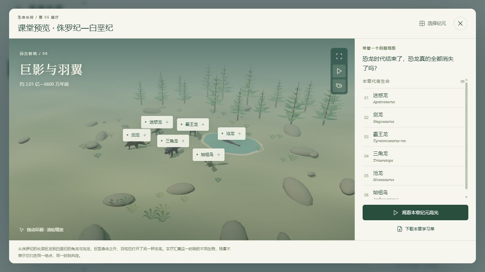
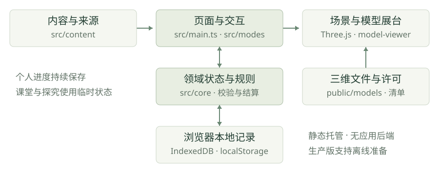

# 生命长河详细项目介绍

## 01 项目概览

《生命长河》是一座在浏览器运行的生命演化史科普馆。它把八个纪元、48个生命档案、可交互三维展台、证据探究和演化教学实验组织成连续的学习体验：从观察一个身体，到查阅它的来源，再用证据解释自己的判断。

项目优先服务科普教育与智慧教育类比赛的展示准备，也可延伸至数字展陈和创新实践方向。目标使用者为小学高年级、初中阶段的学习者，以及需要课堂展示工具的教师；年龄、活动时长和教学适配仍属于待试测的设计假设。

当前版本为已上线、可验证的科普教育原型，未完成原方案全部验收条件。没有实际报名、获奖、合作学校或教学效果数据。本文更新于2026年11月2日，以源码基线7c5d904及现有证据为依据；原设计愿景与当前能力分别说明。

在线体验：[https://runner-cpu.github.io/River-of-Life/](https://runner-cpu.github.io/River-of-Life/)。源码：[runner-cpu/River-of-Life](https://github.com/runner-cpu/River-of-Life)。直接用浏览器打开，无需安装或注册。

| 项目要素 | 当前状态 |
| --- | --- |
| 内容规模 | 8个纪元、48个生命档案、144道卡片关联题 |
| 主要模式 | 演化之旅、物种图鉴、化石挖掘、知识挑战、演化实验室 |
| 教学活动 | 3组证据探究、同起点双环境对照、课堂预览与学习单 |
| 三维素材 | 13个外部GLB；其余35个档案以原创结构示意呈现 |
| 技术形态 | TypeScript + Three.js + model-viewer，静态网站 |
| 数据与账号 | 无需注册；个人记录保存在当前浏览器和站点 |
| 离线 | 生产版可主动准备缓存，成功后运行核心活动 |
| 软件验证 | 103项单元测试、36项浏览器测试通过 |

项目的主要贡献是学习活动组织、界面与状态管理、场景整合、结构示意、可复现教学模型和可核对的交付流程。Three.js等基础库及外部模型按其原作者署名，不作为项目自研引擎或全部自制资产。

网站访问与第12节示例实验于2026年11月2日复核；完整软件回归引用2026年10月30日记录。项目优先展示观察、查证、解释和比较的学习过程，软件验证不替代科学审校或教学效果研究。

## 02 项目背景与设计目标

生命演化史涉及漫长时间、不同环境和大量陌生形态。仅看名称与复原图，学习者容易将注意力停留在“谁最大、谁最凶、谁长得奇怪”；缺少问题引导时，身体结构、生活方式和证据来源之间的联系不容易形成。项目以这一设计问题为出发点，让观看、查证与解释发生在同一工具内。

**建立有方向的观察。** 八个纪元以核心问题串联内容，每个档案提供身体结构、年代、环境和误区说明。场景用于寻找兴趣入口，展台用于近距离观察，知识卡用于把观察与文字资料连接起来。

**使依据能够被检查。** 扫描、艺术复原和结构示意分别标明含义；档案显示资料来源，重点探究还说明来源实际支持的范围。学习者需要区分亲眼看到的结构、文字资料中的结论，以及当前材料无法支持的推断。

**支持表达与比较。** 证据活动保留原始判断和解释文字；演化实验让使用者先预测，再比较控制条件下的曲线与逐代数据。体验可以留下可讨论的活动记录和实验文件，而不只是收藏数量。

| 设计问题 | 项目的响应 | 预期使用表现 |
| --- | --- | --- |
| 知识点零散 | 纪元问题、档案与题库连接 | 将对象放进时间与环境语境 |
| 形象容易替代证据 | 资产类型、来源与误区解释 | 说清观察与推断的区别 |
| 操作结束后缺少产物 | 解释记录、学习单和CSV | 展示判断依据与比较过程 |
| 设备与网络条件不同 | 文字路线、响应式与离线准备 | 按使用条件选择入口 |

这些问题和预期表现属于设计假设，尚未形成用户访谈统计或对照研究结论。后续需要通过教师审读、实际操作观察和解释文本分析，判断哪些设计有效、哪些需要调整。

## 03 使用人群与应用场景

项目暂定服务小学高年级和初中阶段学习者，适合在教师、家长或活动主持人的引导下使用。目标年龄与活动用时尚待试测；阅读基础较弱的使用者可先采用投影讲解和口头解释，再逐步增加独立阅读。

教师与学生可以选择不同进入方式。学生沿主线探索，教师直接预览任意纪元；短时活动则从具体问题进入。共享设备时，可由主持人操作、其他人提出观察与解释。

| 场景 | 推荐使用方式 | 可观察产物 |
| --- | --- | --- |
| 个人探索 | 沿章节观察、阅读、答题，逐步开启纪元 | 图鉴、操作记录、题目反馈 |
| 短时课堂活动 | 选择一个证据主题，先判断再查证 | 原始选择、解释文字、可打印记录 |
| 教师投影 | 课堂模式直接选章，近观物种并播放高光 | 课堂问题、学习单、讨论线索 |
| 模型探究 | 固定种子，对比两个环境，再改变种子重复 | 两条频率曲线、逐代CSV |
| 比赛展示 | 三分钟手动路线展示证据活动与对照实验 | 操作画面、说明文稿、验收证据 |

当前不提供学校账号、教师后台、学生名单或跨设备云同步。它更适合作为独立活动工具和展陈原型。若扩展为学校平台，需要另行设计权限、数据治理、内容审核与运维流程。

## 04 产品结构与进入路径

网站以“演化之旅”为首页，左侧导航连接五种主要模式。手机改用可展开的导航抽屉。使用指南提供四条明确路线：自己探索、练习证据解释、教师展示、比较模型结果；每条都直接进入对应活动，不强制完成新手教程。

指南将学习目的写在入口之前，说明哪些记录会保存、哪些属于临时活动。页面标题随模式更新，普通切页写入浏览历史；浏览器返回和前进可恢复路径，图鉴搜索条件保留。导航切换会关闭旧页面的弹窗。

首页另有“3分钟，做一次证据探究”和“90秒看懂生命长河”。前者进入学习活动，后者是可接管的主线演示。自动演示不代表已覆盖全部新功能；比赛重点展示证据探究与对照实验时，应使用手动脚本。

手机指南改为单列，提供与桌面一致的功能入口。长内容在弹窗主体内滚动，关闭按钮保持可见。

## 05 生命内容与知识组织

每章包含6个代表生命档案，章节以问题和核心认识组织内容。下表摘录项目现有章节设计，用于说明课程结构；年代与科学叙事仍应结合具体来源和专业审校。

| 纪元 | 章节题目 | 学习焦点 |
| --- | --- | --- |
| 前寒武纪 | 一束光，改写海洋 | 微生物改变环境；早期生命证据 |
| 寒武纪 | 身体的万种可能 | 身体结构、捕食、防御与生命辐射 |
| 奥陶纪至泥盆纪 | 潮线之外 | 水陆过渡、植物与脊椎动物线索 |
| 石炭纪至二叠纪 | 森林之高，危机之深 | 环境变化、适应与生态危机 |
| 三叠纪 | 废墟上的新脚步 | 灾变后的幸存、重建和支系扩展 |
| 侏罗纪至白垩纪 | 巨影与羽翼 | 鸟类、非鸟恐龙与海生爬行动物 |
| 古近纪至新近纪 | 新的巨兽，新的家园 | 哺乳动物分化与不同环境路线 |
| 第四纪 | 冰退之后，轮到我们 | 气候摆动、人类与当代保护问题 |

档案包含中文名、学名、年代、代表尺寸、分类、营养方式、栖息环境、基本定义、趣味事实、误区说明、后续命运和来源。条目既有物种或属，也有更大的类群和群落，因此统一称为“生命档案”，不能简单宣传为48个严格物种。

章节展景汇集代表生命，不表示它们在同一地点、同一时刻共存。场景布局不遵守所有生物的真实尺寸比例；大小比较应阅读独立尺寸标注。程序和题库的字段关联可以自动检查，科学事实本身仍需人工审核。

## 06 演化之旅与探索激励

个人路线由观察、阅读、答题、纪元事件和下一章解锁组成。点击场景生物名称即可打开展台，第一次发现免费加入图鉴。每章主任务为观察3个生命、阅读3张档案和答对3道关联题；完成后可见证纪元大事件。

| 行为或规则 | 当前实现 | 设计目的 |
| --- | --- | --- |
| 学习奖励 | 同一观察、阅读、题目与挖掘只结算一次 | 避免反复点击刷取奖励 |
| 下一章 | 章节开启费用150演化点 | 维持任务与推进之间的联系 |
| 可选收藏 | 普通/珍稀/明星为20/35/60点 | 提供选择，不阻断主要学习 |
| 主线储备 | 可选消费为未开启的下一章保留150点 | 避免收藏后无力继续 |
| 免费发现 | 首个发现与每章化石可免费收藏 | 让开始探索具有即时反馈 |
| 课堂与演示 | 使用独立临时进度 | 展示操作不改写个人图鉴 |

经济通路的自动模拟表明，有限奖励足以完成全部章节和收藏；该结论只说明数值路径可达，不证明学习者可以在规定时间完成。每章目前仍采用相同的观察、阅读和答题主任务，专属任务叙事可继续增加。

八章分别提供约10秒的三维高光，通过相机、粒子和可选合成音表现产氧、生命辐射、缺氧、火山、撞击、草地与冰盖等主题。支持暂停、跳到总结、重温和课堂预览；减少动态时使用静态关键帧。它们是教学压缩表达，不是灾变过程的科学数值仿真。

## 07 图鉴 三维展台与化石挖掘

图鉴支持关键词、纪元和收藏状态筛选，并能清除组合条件。卡片从桌面多列布局调整为手机图文并排布局，重要信息保持固定层级：名称、学名、概要、收藏状态。展台关闭后，计数与卡片立即更新，并回到原卡片的键盘焦点和浏览位置。

三维展台支持拖动旋转、缩放、自动旋转、代表尺寸对比与中文朗读。知识栏提供主要事实、误区解释、来源及模型署名。外部模型加载失败时显示原因，回退到明确标注的结构示意；网络恢复后可重试原模型，包括模型清单首次加载失败的情况。

尺寸条以卡片的代表值线性比较，并区分体长、身高、翼展或结构尺寸。微小生物为辨认而放大时会提示。模型、条形和AR中的尺寸不能不加区分地称为实物的精确尺寸。

化石挖掘提供刮擦交互和逐区清理按钮两条操作路径。触屏用户可以刮开岩层，键盘使用者可用按钮逐步完成。完成后连接对应档案，奖励唯一记账；刷新不会重新发放同一奖励。

| 表现形式 | 可以帮助观察什么 | 不能据此直接推断什么 |
| --- | --- | --- |
| 馆藏扫描 | 所扫描标本的表面和保存状态 | 完整活体颜色、行为或所有缺失组织 |
| 开放许可复原 | 艺术家建构的身体外形和姿态 | 所有细节均获科学确认 |
| 原创结构示意 | 身体主要部件与教学观察线索 | 高精度复原或模型数量已达原目标 |

## 08 知识挑战与学习反馈

知识挑战包含快问快答、时间排序、生命连线、每日挑战和历史错题练习。144道选择题关联具体档案字段，反馈解释能回到知识卡与来源。排序强调出现时间的相对关系；生命连线帮助比较营养方式。

界面使用“曾答对”，准确表达系统记录的含义。答题后同时标注“本题答案”和“你的选择”，不只依靠颜色区分。反馈标题接收焦点，下一次Tab可到继续按钮；换题后焦点回到题目。重复答对时明确说明本题已获奖励。

手机生命连线使用独立的全宽选择框，长营养方式不再挤在名称旁。极窄屏排序省略装饰图，保留名称与移动按钮。以上改善降低阅读和操作负担，但尚未完成读屏器组合测试或正式无障碍认证。

选择题记录不能代替理解评估。教师应结合解释内容观察学生是否能指出证据、说明推理，以及认识模型或资料的局限。历史错题是发生过的错误记录，不宜解释为当前仍未掌握的完整诊断清单。

## 09 证据探究活动

三组主题分别围绕始祖鸟、沧龙和提塔利克鱼展开。活动入口无需解锁全部章节，使用独立临时会话，适合短时课堂或比赛演示。三维观察和文字路线都能完成；设备不能显示3D时仍可参与。

| 阶段 | 学习者操作 | 系统如何回应 |
| --- | --- | --- |
| 初始判断 | 从选项中记录原始想法 | 保留选择，允许错误与不确定 |
| 观察查证 | 进入展台或阅读文字证据 | 展示资料、出处和具体核对范围 |
| 选择依据 | 判断哪条证据能支持观点 | 给出解释，区分线索与结论 |
| 迁移问题 | 对新的情境作判断 | 检查能否迁移关系，而非只认名字 |
| 自我解释 | 写“观点、证据、理由” | 显示字数并导出可打印活动记录 |

活动不把答错作为通行阻碍，也不自动给自由文字打分。导出的解释供本人或教师讨论，记录原始选择便于回看观点是否改变。活动会话不会自动云存储，关闭或刷新前应导出需要保留的记录。

三组重点探究补充了博物馆或大学资料。每条资料只为标注范围提供支持，不为整张卡片的所有年代、体型和推断背书。以身体特征支持比较，并不自动证明某个标本就是另一个类群的直接祖先；这是活动中需要练习的推理边界。

项目已准备教师观察框架，尚未收集真实学生样本。软件测试中的解释文字仅用于验证输入和导出，不属于教学研究结果。

## 10 使用案例 始祖鸟证据解释

以始祖鸟主题为例，活动首先提出“看到羽毛后可以得出什么判断”。学习者先保留自己的想法，再进入展台寻找可见线索。扫描中看不清的结构应转向文字资料核对，不能因为提示中出现某个词，就声称已经在模型上观察到它。

| 阶段 | 建议操作 | 应保留的思考 |
| --- | --- | --- |
| 记录判断 | 选择原始想法或暂时不确定 | 我现在依据的是什么 |
| 观察查证 | 旋转化石，阅读特征与来源范围 | 哪些来自标本，哪些来自资料 |
| 选择证据 | 比较结构与名字、配色等信息 | 什么材料真正支持当前观点 |
| 迁移解释 | 判断另一块有羽毛化石能说明什么 | 相似是否足以证明直接祖先 |
| 留存记录 | 写下观点、证据、理由并导出 | 我的想法是否改变，为什么 |

**可用于讲解的示例：**“我不能只凭羽毛判断它与今天的鸟完全一样。活动资料还列出了牙齿、长骨尾等需要一起比较的特征。多个特征能帮助讨论关系，但仍不足以单独证明一个标本是所有现代鸟的直接祖先。”这是项目讲解示例，不是真实学生作答或教学研究结果。

示例内容来自项目已登记资料及其核对范围。活动引用伦敦自然历史博物馆的相关介绍，登记核对日期为2026年10月30日；范围见src/content/learning-sources.ts。该资料不为整张卡片的全部年代、尺寸与推断提供共同背书。

教师可以追问“你实际观察到了什么”“哪条资料支持这句话”“还不能推出什么”，分别检查观察、依据与推理边界。活动应留下可讨论的解释，不仅以操作次数或是否选对答案判定理解程度。

## 11 演化实验室与对照实验

实验室分为实时种群观察和独立对照实验。上方允许调整干旱与捕食选择、逐代前进、连续运行和重置；下方先记录预测，再以相同起点比较两个环境的30代结果。两部分有清楚的分区导航。

对照组干旱固定为0%，实验组取运行时的设置值，两组种群规模、突变率和捕食参数一致。随机种子可修改，结果包含双曲线、逐代表格和CSV。导出记录绑定运行时参数；改变参数、种子或预测后，旧结果保留并显示需重新运行的提示。

实时实验在打开弹窗或切换窗口时暂停，返回后需手动继续，避免世代在用户阅读时悄悄推进。状态行说明当前暂停原因与离开页面将重置实验。连续观察设有300代上限；需要保存对照结果时应先导出CSV。

固定种子保证同样输入可复现模型输出。更换种子是讨论随机差异的入口，一条曲线并不能建立普遍生物规律。0%干旱仍包含代码设定的性状成本，不能把该组称为完全没有选择的自然环境。

## 12 教学模型与可复现实例

模型使用100个单倍体个体，每个个体具有14个二值基因。第0位影响耐旱性状的繁殖权重，第1位影响捕食选择项，其余位点在当前适合度公式中为中性。每一代按繁殖权重有放回抽取亲本，复制基因并施加独立翻转突变，形成同样大小的新种群。

设d为干旱强度，p为捕食选择强度，g0和g1为前两位基因，则代码中的权重为：

`w = max(0.05, 1 + 0.9*d*g0 - 0.15*(1-d)*g0 + 0.15*p*g1)`

这些系数是教学模型参数，并非从特定真实物种的实验估计而来。突变率默认每位点每代0.003。页面将基因0的平均值作为耐旱等位基因频率，观察选择和抽样随机性共同产生的变化。

2026年11月2日直接运行现有compareEnvironments函数，以种子20261025、实验组干旱0.8、捕食0.2、30代为条件，得到以下基因0频率。这是程序模型输出，不是生物实验或学生数据。

| 世代 | 对照组 干旱0% | 实验组 干旱80% |
| --- | --- | --- |
| 0 | 0.51 | 0.51 |
| 10 | 0.23 | 0.99 |
| 20 | 0.09 | 0.99 |
| 30 | 0.05 | 0.96 |

仅把种子改为42，初始频率变为0.55，第30代分别为0.01和1.00。两个种子不足以建立总体统计结论；相同输入重复运行用于检查复现，更换种子的重复用于讨论随机变化。

模型没有二倍体显隐性、交配重组、迁移、食物网或真实捕食追逐。每个个体能量设为10，新代入账、旧代出账，余额残差为0只说明记账一致。它适合解释机制、控制变量与模型边界，不用于预测真实种群或保护管理结果。

## 13 课堂组织与学习反馈

课堂模式直接开放任意纪元，教师无需先积累演化点。界面可查看全景、聚焦单个对象、循环切换同章6个档案，阅读观察提示，播放纪元高光并导出HTML学习单。投影大字与减少动效设置适配讲解场景。

以下为15分钟短活动建议，属于待试测教学设计，并非已经测得的完成时间。共享设备时，学生可口述、教师操作；时间不足时，可把对照实验安排到下一次活动。

| 时间 | 教师组织 | 预期产物 |
| --- | --- | --- |
| 0至2分钟 | 提出问题，说明扫描与复原区别 | 原始判断或不确定项 |
| 2至5分钟 | 进入证据主题，观察并阅读资料 | 一条与问题相关的线索 |
| 5至8分钟 | 比较依据并完成迁移问题 | 对依据有效性的解释 |
| 8至11分钟 | 交流观点，写下理由 | 导出的个人或小组记录 |
| 11至14分钟 | 展示固定种子的双环境对照 | 指出改变变量与保持条件 |
| 14至15分钟 | 回看限制，提出一个新问题 | 仍需证据的追问 |

反馈建议分别观察四项：观点是否回应问题，证据是否相关且来源明确，理由是否连接证据与结论，是否指出仍不能推出的内容。现有材料提供0至2分反馈草案，尚不是标准化量表，不宜直接压缩为一个“科学能力分”。

真实试测应先做教师审读和可用性观察，再考虑学习效果研究。记录须说明参与安排、年级范围、设备、完成状态、耗时与求助点，保留错误和中断案例。当前没有真实学生样本、合作学校或提升百分比，这些信息只能在实际实施后填写。

课堂方案及匿名观察表见docs/competition/teaching-and-evaluation.md。活动记录由使用者主动导出，系统没有班级后台，不自动汇总教师成绩。

## 14 视觉设计与可访问性

界面采用分层阅读：章节主题与主要动作优先，事实、辅助说明和来源随后展开。图鉴卡片、弹窗和实验结果共用间距与文字层级，长说明限制阅读宽度，手机将并列布局转换为单列或图文组合。

弹窗标题和关闭入口固定，内容区域独立滚动。关闭后恢复仍有效的触发元素焦点，避免页面跳动。手机导航关闭时不暴露隐藏链接，展开时限制焦点在抽屉内；Esc可以关闭。挑战页签支持方向键、Home与End。

关键状态提供文字而非只有颜色。挖掘有按钮替代路径，实验曲线有逐代数据，探究有纯文字路线。设置提供投影大字、减少动态和画面质量；新存档沿用系统减少动态偏好。尚未完成完整读屏器、200%缩放、多浏览器和真机无障碍验证。

场景负责引出问题，档案负责连续阅读；模型、知识与来源应有明确层级。手机的操作区域、稳定关闭入口和焦点恢复，共同支持观察后继续阅读。

## 15 三维素材与知识来源

当前发布13个外部GLB文件，合计11,989,972字节；每个不超过2MiB和20,000个三角形。10个为动画复原，3个为馆藏扫描。其余35个档案使用明确标注的原创结构示意，不计入原方案至少24个外部模型的目标。

| 资产组 | 数量与对象 | 来源与处理 |
| --- | --- | --- |
| CC0动画复原 | 4：迷惑龙、剑龙、霸王龙、三角龙 | Quaternius；FBX转GLB，保留材质、骨骼与动画 |
| CC0馆藏扫描 | 3：始祖鸟化石板、猛犸骨架、巨齿鲨牙齿 | Smithsonian；处理方向与单位，保留标本属性 |
| CC BY 4.0复原 | 6：奇虾、欧巴宾海蝎、怪诞虫、异齿龙、沧龙、水龙兽 | 保留原作者与衍生动画贡献者；压缩纹理与几何 |
| 原创结构示意 | 35个档案 | 程序化部件与SVG；用于结构教学，需继续审校 |

扫描标本不作为活体模型放进生态场景。已对始祖鸟结构示意单独改善身体、羽翼和脚爪；怪诞虫与欧巴宾海蝎处理了默认姿态与展台取景不一致的问题。模型加载成功还需检查实际画面可见，不能只看网络请求是否成功。

网站保留暖白底、低饱和绿色和自然展陈风格。场景与图鉴承担不同视觉任务：场景提供整体关系，图鉴提供精确信息。近观模式提供名称、年代、尺寸和观察提示，并支持循环查看同章6个档案。

模型来源、作品名、作者、许可、修改和衍生来源记录在CREDITS.md及发布清单中。许可可用不等于科学质量达标；未来资产应同时通过权属、形态、预算和移动端观察检查。

## 16 技术架构与状态管理

项目采用静态前端结构，以严格TypeScript组织领域逻辑，Three.js负责生态场景与结构示意，model-viewer负责独立模型展台和设备支持下的AR入口。没有后端、账号系统、在线大语言模型或云数据库。

| 层次 | 主要位置 | 职责 |
| --- | --- | --- |
| 内容层 | src/content | 章节、档案、题目、探究主题 |
| 领域层 | src/core | 进度、账目、实验、探究状态、持久化 |
| 交互层 | src/modes | 图鉴、展台、挖掘、答题、课堂与指南 |
| 场景层 | src/scene | Three.js构图、资源、动画与清理 |

主要数据流为：已发布内容进入界面，用户动作调用状态方法，状态方法校验并结算，再更新界面与本地记录。个人进度与课堂、演示、探究临时状态分开，减少展示操作对个人学习记录的影响。

Progress记录章节、观察、阅读、收藏、答题、挖掘、徽章与设置，并包含版本及更新时间。导入不仅检查字段类型，也检查进度关系和奖励账目，避免不一致记录破坏主线。

当前工具版本为Vite 6.4.5、Vitest 4.1.12、Three.js 0.183.2、model-viewer 4.4.0；完整解析版本以package-lock.json为准。保留原有技术栈有利于延续现有验证，但大文件中的DOM模板与多层CSS仍存在维护成本，可在后续按功能逐步拆分。

## 17 本地记录与隐私设计

个人进度以IndexedDB为主要存储，并保留localStorage备份。系统对存储异常提供回退；仍应提醒使用者主动导出重要记录。不同浏览器、协议、主机或端口拥有不同站点数据空间，换地址并不会自动迁移原记录。

| 数据或能力 | 当前处理 | 使用者需了解 |
| --- | --- | --- |
| 个人探索 | 保存在当前站点浏览器数据中 | 清理站点数据会丢失；先导出备份 |
| JSON导入 | 验证结构、状态关系和账目 | 导入前保留自己的记录 |
| 探究解释 | 临时会话、手动导出 | 不自动上传，不提供在线AI评分 |
| 对照结果 | 本次页面内保存、导出CSV | 离页重置，需主动留存 |
| 外部来源 | 用户打开后访问对应网站 | 不属于本地离线缓存的完整内容 |
| 中文朗读与AR | 调用浏览器或设备能力 | 可用性及网络行为依赖系统服务 |

应用没有广告或学习行为统计后台，不请求用户注册。这个架构减少了项目自身的数据收集，但不能据此宣称操作系统语音、外部资料网站或AR服务都没有各自的数据处理行为。

“达尔文导览”以48张已发布卡片和384条确定性规则组织回答，提供八类建议话题。它按当前档案字段返回解释并保留来源入口；超出范围时使用保守提示。该能力不具备通用联网问答或在线大语言模型能力。

## 18 离线运行与稳定性设计

离线能力只在生产构建启用。首次成功访问缓存应用代码与知识，使用者再从“探索设置—准备离线展馆”补齐模型。界面按资源数量显示进度，并等待最终成功回复；开发服务器不注册Service Worker，避免缓存干扰开发。

完整准备后，核心知识、模型和活动可以使用缓存。外部参考网页不属于完整离线包，设备语音与AR也不保证断网可用。展示前应在实际设备完成准备并断网检查，缓存被清理后需要重新准备。

| 可能出现的情况 | 已实现的处理 |
| --- | --- |
| 模型清单或模型请求失败 | 标注失败、结构示意回退、原模型重试 |
| 图形能力不可用 | 基础信息回退，证据活动保留文字路线 |
| 离线准备等待过长 | 安装与缓存等待设置超时，可重试 |
| 本地数据库异常 | 备份与回退，支持主动导出 |
| 实验被弹窗或隐藏页面遮挡 | 暂停推进，用户手动恢复 |
| 场景暂停或离屏 | 停止不必要的持续绘制，清理资源 |

性能策略包括按需加载模型、拆分应用与图形库代码、限制资产预算、降低画面质量，以及在关闭场景时释放监听与资源。模型网络加载成功还需检查画面实际可见，避免镜头取景为空。

历史结构采样显示八章均低于150,000三角形阈值，但只对应指定视角和环境。真实手机帧率、温升、耗电与长时内存仍待测量，不能从自动化软件WebGL环境推导所有设备都流畅。

缓存版本与构建内容哈希关联，离线准备过程检查协议和最终完成状态。程序测试验证了相应成功与失败路径，但现场展示仍应保留联网与独立本地包两种可用入口。

## 19 软件验证与结果范围

本节引用2026年10月30日完整软件验收，2026年11月2日文档修订未将这些记录改写为新的全面回归结果。

本节记录的本地生产构建于2026年10月30日20:04:26完成。构建门禁检查48个档案、8个章节、144道题、来源登记、模型文件与预算，以及严格TypeScript。单元测试13个文件共103项通过。

完整Playwright Chromium回归于20:11:43开始，耗时约106.5秒，36项全部通过，0失败、0跳过、0不稳定重试。测试覆盖主线奖励、存档异常、挖掘、演示隔离、课堂近观、八章高光、13模型实际可见、无WebGL回退和离线重载等。

新增回归包括浏览器返回/前进、图鉴即时同步、模型清单失败重试、320px答题标记与焦点、实验弹窗暂停、指南路线。扩展用例还验证种子与预测变更提示，以及离线进度消息不会提前结束准备。

人工视觉检查包括桌面指南、1280×720设置与实验室，以及390×844指南、纠错和生命连线。截图以deep-开头保存；已有课堂、模型和探究截图按对应历史报告保留。测试文本均为验证数据，不是学生数据。

| 证据文件 | 可核对内容 |
| --- | --- |
| evidence/build-verification.json | 构建时间、内容哈希、资源统计与方法 |
| evidence/e2e-results.json | 该次完整浏览器用例和耗时 |
| evidence/model-validation.json | 13模型大小、三角形、动画与哈希 |
| evidence/e2e-scene-budgets.json | 八章指定视角的结构统计 |
| evidence/dependency-audit-after.json | 官方npm审计当日记录 |
| evidence/acceptance.md | 对应验收摘要及未完成条件 |

上述本地构建的发布内容SHA-256：

`784388bd0d9579fe7144deb0b19eb6163c91ca6f0fe89303d800e71f6d8139ee`

上述证据证明特定构建在特定环境中的行为。它们不能证明知识全部正确、形态已经专家认可、所有设备都流畅，或学生学习效果已经提高。

资源统计：应用assets内JS/CSS逐文件gzip合计423,907字节，所有非GLB资源逐文件gzip合计630,296字节，13个GLB合计11,989,972字节。gzip为级别6的独立文件统计，不等于首屏传输量。依赖审计在2026年10月30日为0条已知漏洞，不等于永久安全或完整安全认证。

## 20 项目特色与开发贡献

项目的特色集中在学习活动与实现方式的组合：以纪元组织内容，以三维观察引出问题，以可核对资料支持解释，再用简化模型练习比较。以下是当前实现可以展示的贡献，不构成“行业首创”、专利新颖性或优于所有同类产品的判断。

**观察与证据相连。** 独立展台、知识卡、来源入口和探究活动处于连续路径上。使用者不仅接收复原形象，还要判断哪些信息可以作为依据。模型类型与来源范围提示有助于形成更谨慎的科学表达。

**活动留下可讨论的产物。** 原始判断、解释文字、学习单与CSV可导出，便于课堂讨论和后续整理。系统保留过程，不自动宣称掌握程度，也不把自由表达交给未经验证的自动评分。

**实验可以复现和追查。** 固定种子、相同初始种群、控制条件与运行参数快照，使曲线可以回到对应设置。改变参数后要求重新运行，降低旧结果被误当成新实验的风险。

**不同场景有不同入口。** 个人探索采用任务推进，课堂直接开放内容，短活动从具体问题进入。文字路线、键盘操作、投影设置和生产版离线准备，使使用方式更灵活。

**交付质量有材料可核对。** 内容与模型清单、预算检查、回归、实际截图、许可和AI披露组成验证材料。文档同时保留未完成项，页面数量不能替代科学审校、教学试测与真机证据。

开发贡献主要包括交互流程、状态与奖励管理、场景装配、程序化结构示意、教学仿真、响应式界面和质量检查，过程包含AI辅助。Three.js、model-viewer与外部模型分别属于其原作者的基础组件或素材贡献，署名应随作品保留。

## 21 在线访问与本地部署

在线展馆：[https://runner-cpu.github.io/River-of-Life/](https://runner-cpu.github.io/River-of-Life/)。源码仓库：[https://github.com/runner-cpu/River-of-Life](https://github.com/runner-cpu/River-of-Life)。普通体验直接打开网站；本地开发与独立展示按下列步骤运行。

本地开发曾在Windows与Node.js 24.19.0环境验证。源码目录执行npm ci安装锁定依赖，再运行npm run dev，打开终端显示的本地地址。开发服务默认只监听127.0.0.1，端口占用时以终端实际输出为准。

| 命令 | 用途 |
| --- | --- |
| npm ci | 按package-lock.json安装依赖 |
| npm run dev | 启动开发预览，默认5173 |
| npm run build | 内容/模型/类型检查与生产构建 |
| npm test | 运行单元测试 |
| npm run test:e2e | 完整生产版浏览器回归 |
| npm run verify:build | 记录当前构建身份与资源统计 |
| npm run preview | 预览dist，默认4173 |
| npm run package:competition | 验证结果匹配后生成展示准备包 |

首次安装测试浏览器可运行npx playwright install chromium。离线展馆需要生产版：先构建、启动preview，进入设置完成离线准备，看到成功提示后再断网。不要直接双击源码或site目录的index.html。

独立展示包包含site、materials、verification、screenshots、来源披露和serve.mjs。在包目录执行node serve.mjs，然后访问http://127.0.0.1:4180/；如端口占用可运行node serve.mjs 4181。无需安装npm依赖，但需要Node.js。PDF和评审说明可单独阅读。

网站已于2026年10月30日通过GitHub Pages发布并启用HTTPS。推送main后，Publish museum工作流自动执行测试、校验、构建与部署，也支持手动运行；状态见[发布工作流](https://github.com/runner-cpu/River-of-Life/actions/workflows/pages.yml)。资源使用相对路径以支持仓库子目录。AR仍需兼容设备及真机验收。

2026年11月2日再次请求线上首页返回HTTP 200，入口脚本为index-B7xP_END.js，与此前验证版本一致。普通main推送触发发布；文档专用提交可能标注跳过CI，实际部署版本以Actions记录为准。既有独立展示包保留生成时快照，新文稿应随新包重新核验。

## 22 比赛展示与项目讲述

**简要介绍口径：**“生命长河是一座可以在浏览器直接打开的生命演化史科普馆。它用八个纪元和48个档案连接三维观察、证据探究与教学实验，让学习者从认识一个生命，继续走到解释判断依据。作品已公开上线，提供本地记录、课堂展示与离线准备，仍需专业审校、真实课堂试测和更多设备验证。”

主投方向建议保持科普教育。展示重点应是观察、查证、解释与对照，而不是只展示模型数量或动画。数字展陈方向可以突出分章空间、近观、临时课堂与离线；创新实践方向可以突出本地状态、可复现模型、内容门禁和交付验证。具体赛事资格、主题、格式与AI披露须按目标赛事当届规则另行核对。

| 三分钟排练段落 | 操作重点 | 需要讲清的价值 |
| --- | --- | --- |
| 0:00至0:40 | 首页进入证据探究，记录一个判断 | 从认识名字走向解释 |
| 0:40至1:15 | 旋转扫描，查看资料与核对范围 | 区分观察、证据和复原 |
| 1:15至1:45 | 选择证据，写一句解释并展示导出 | 保留思考过程，不只追求分数 |
| 1:45至2:20 | 运行同起点对照，查看曲线和数据 | 控制变量、复现与模型边界 |
| 2:20至2:40 | 课堂模式进入另一纪元近观 | 教师和学生均有可用路线 |
| 2:40至3:00 | 展示验收和未完成项 | 贡献、来源、AI与证据透明 |

答辩时应清楚说明：外部模型有来源与许可，不能宣称全部自制；本地导览是规则检索，不能宣称在线大模型问答；教学效果尚未研究，不能提供虚构提升率。自动演示、脚本和截图不能替代正式录屏成片与真实设备AR演示。

当前已准备作品介绍、教学方案、答辩脚本、来源披露与展示包。正式提交还需真实团队信息、赛事模板、录屏与声明，应由实际参赛成员确认和完成，不预填虚构姓名、学校、奖项或合作信息。

## 23 当前不足与发展计划

当前最重要的后续工作是补充质量证据，而非继续堆叠页面。原方案要求至少24个合格外部模型，目前13个，尚差至少11个；35个结构示意也使自制占位比例超过原约束。模型目标应以科学形态、许可和可用性共同衡量。

| 优先级 | 工作项 | 完成时应提供的证据 |
| --- | --- | --- |
| P1 | 重点档案与活动专业审校 | 逐字段意见、修改记录、审核范围 |
| P1 | 合格模型补足和形态精修 | 来源许可、可见截图、预算与专家意见 |
| P1 | 真实课堂小规模试教 | 经合适同意的匿名记录、问题与迭代 |
| P1 | 真实设备性能与AR | 设备/系统/浏览器、实测数据与录屏 |
| P2 | 具体赛事材料定稿 | 规则映射、正式成片、真实署名与声明 |
| P2 | 跨浏览器与无障碍扩展 | 读屏器、缩放、触摸和错误状态记录 |
| P2 | 章节专属任务与内容升级 | 更丰富的观察问题、来源核对范围 |
| P3 | 工程维护性改进 | 模块拆分、CSS收敛、回归结果 |

当前已改善导航、状态反馈、离线进度和可读性。后续可完善语音停止和播放状态、长时间使用恢复策略，以及更多学校环境下的操作提示。在线问答、云同步或教师后台应有明确需求后再设计；它们会增加数据、维护和内容审核责任。

项目现有优势是能把内容、观察、解释、实验与实际输出连起来，并保留来源和验证证据。是否形成教学优势，需要课堂资料支持；是否适合某项比赛，需要按具体规则复核。当前不标记原方案全部里程碑完成。

## 24 资料索引与使用说明

文档更新于2026年11月2日。软件度量保留2026年10月30日记录，示例实验为本次直接运行结果；截图均为实际界面，采集时间见图注。外部知识的完整网址、核对日期和作用范围在应用知识卡及src/content中；资产来源、作者和许可在CREDITS.md与public/models/manifest.json。本文不替代逐条科学文献审查。

| 资料 | 用途 |
| --- | --- |
| README.md | 启动、功能概览与当前边界 |
| docs/design-spec.md | 用户方案副本，代表目标而非完成证明 |
| docs/delivery-status.md | 当前实现与原要求之间的差距 |
| docs/competition/ | 简介、教学方案、演示答辩和提交清单 |
| evidence/comprehensive-refinement.md | 30维度分析、修改与复核 |
| evidence/content-report.md | 既有内容核对与修订记录 |
| CREDITS.md、AI_USAGE.md | 外部贡献、许可和AI辅助范围 |

档案来源采用A至D级登记：A为学术文献，B为科研或博物馆机构，C为百科参考，D为待证实或设计参数等。当前内容以C级为主，重点探究补充B级；等级是编辑工作线索，不能自动保证某条内容正确。

GLB是二进制三维资产格式；结构示意强调主要部件关系；随机种子确定伪随机序列；基因频率是模型种群中某个基因取值的比例；Service Worker是浏览器用于缓存等后台能力的机制；SHA-256用于核对文件或发布内容是否一致，不能单独证明内容质量。

项目使用AI辅助编程、结构示意、内容整理、测试和文稿起草，具体范围见AI_USAGE.md。产品中的本地导览是规则检索，不是在线大语言模型；没有向模型服务上传学生解释。文档中的测试结果与截图来自实际执行，未生成虚构用户、奖项或教学数据。

2026年10月30日本地验收报告中的“远程发布尚未完成”属于部署前快照，当前线上状态见第21节。软件报告、独立展示包和文稿有各自的生成时间，引用时应说明版本。

本文可用于项目理解、展示准备和后续协作。具体报名材料中的作者、学校、指导教师、组别与签署信息，应按实际情况补充。新增架构图为根据源码绘制的矢量说明，不是网站实际截图。
