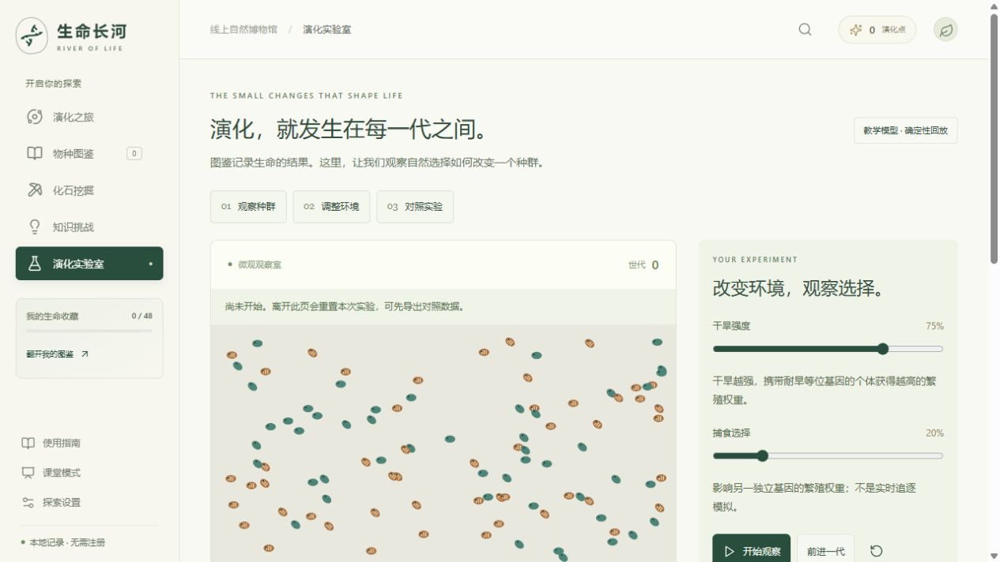

# 生命长河 · River of Life

## 01 项目概览

《生命长河》是一座在浏览器运行的生命演化史科普馆。它把八个纪元、48个生命档案、可交互三维展台、证据探究和演化教学实验组织成连续的学习体验：从观察一个身体，到查阅它的来源，再用证据解释自己的判断。

项目优先服务科普教育与智慧教育类比赛的展示准备，也可延伸至数字展陈和创新实践方向。目标使用者为小学高年级、初中阶段的学习者，以及需要课堂展示工具的教师；年龄、活动时长和教学适配仍属于待试测的设计假设。

当前版本为已上线、可验证的科普教育原型，未完成原方案全部验收条件。没有实际报名、获奖、合作学校或教学效果数据。本介绍以2026年10月30日的代码、构建、测试与上线记录为准；原设计愿景与当前能力分别说明。

在线体验：[https://runner-cpu.github.io/River-of-Life/](https://runner-cpu.github.io/River-of-Life/)。浏览器直接访问，无需安装或注册。

| 项目要素 | 当前状态 |
| --- | --- |
| 内容规模 | 8个纪元、48个生命档案、144道卡片关联题 |
| 主要模式 | 演化之旅、物种图鉴、化石挖掘、知识挑战、演化实验室 |
| 教学活动 | 3组证据探究、同起点双环境对照、课堂预览与学习单 |
| 三维素材 | 13个外部GLB；其余35个档案以原创结构示意呈现 |
| 技术形态 | TypeScript + Three.js + model-viewer，静态网站 |
| 数据与账号 | 无需注册；个人记录保存在当前浏览器和站点 |
| 离线 | 生产版可主动准备缓存，成功后运行核心活动 |
| 软件验证 | 103项单元测试、36项浏览器测试通过 |

项目的主要贡献是学习活动组织、界面与状态管理、场景整合、结构示意、可复现教学模型和可核对的交付流程。Three.js等基础库及外部模型按其原作者署名，不作为项目自研引擎或全部自制资产。

## 02 问题、目标与适用场景

项目围绕三个设计问题展开。第一，学习者可能记住古生物名称和体型，却难以把身体特征、年代和环境联系起来。第二，漂亮的复原形象容易被误当作完整的事实。第三，零散知识缺少可操作的判断、查证和解释过程。这些是设计出发点，不是已经完成用户研究后的统计结论。

相应目标是：让学习者找到观察入口；能辨别扫描、复原和结构示意；能将观点与资料中的证据关联；能在简化模型中比较控制条件下的变化。活动记录辅助讨论，不将点击、收藏或题目答对次数直接换算成知识掌握程度。

| 场景 | 推荐使用方式 | 可观察产物 |
| --- | --- | --- |
| 个人探索 | 沿章节观察、阅读、答题，逐步开启纪元 | 图鉴、操作记录、题目反馈 |
| 短时课堂活动 | 选择一个证据主题，先判断再查证 | 原始选择、解释文字、可打印记录 |
| 教师投影 | 课堂模式直接选章，近观物种并播放高光 | 课堂问题、学习单、讨论线索 |
| 模型探究 | 固定种子，对比两个环境，再改变种子重复 | 两条频率曲线、逐代CSV |
| 比赛展示 | 三分钟手动路线展示证据活动与对照实验 | 操作画面、说明文稿、验收证据 |

当前不提供学校账号、教师后台、学生名单或跨设备云同步。它更适合作为独立活动工具和展陈原型。若扩展为学校平台，需要另行设计权限、数据治理、内容审核与运维流程。

## 03 信息架构与使用入口

网站以“演化之旅”为首页，左侧导航连接五种主要模式。手机改用可展开的导航抽屉。使用指南提供四条明确路线：自己探索、练习证据解释、教师展示、比较模型结果；每条都直接进入对应活动，不强制完成新手教程。

指南将学习目的写在入口之前，说明哪些记录会保存、哪些属于临时活动。页面标题随模式更新，普通切页写入浏览历史；浏览器返回和前进可恢复路径，图鉴搜索条件保留。导航切换会关闭旧页面的弹窗。

首页另有“3分钟，做一次证据探究”和“90秒看懂生命长河”。前者进入学习活动，后者是可接管的主线演示。自动演示不代表已覆盖全部新功能；比赛重点展示证据探究与对照实验时，应使用手动脚本。

说明：此图是实际浏览器界面，标题和按钮均来自已实现页面；不是概念稿。手机指南改为单列，长内容在弹窗主体内滚动，关闭按钮保持可见。

## 04 内容结构：八个纪元、48个档案

每章包含6个代表生命档案，章节以问题和核心认识组织内容。下表摘录项目现有章节设计，用于说明课程结构；年代与科学叙事仍应结合具体来源和专业审校。

| 纪元 | 章节题目 | 学习焦点 |
| --- | --- | --- |
| 前寒武纪 | 一束光，改写海洋 | 微生物改变环境；早期生命证据 |
| 寒武纪 | 身体的万种可能 | 身体结构、捕食、防御与生命辐射 |
| 奥陶纪至泥盆纪 | 潮线之外 | 水陆过渡、植物与脊椎动物线索 |
| 石炭纪至二叠纪 | 森林之高，危机之深 | 环境变化、适应与生态危机 |
| 三叠纪 | 废墟上的新脚步 | 灾变后的幸存、重建和支系扩展 |
| 侏罗纪至白垩纪 | 巨影与羽翼 | 鸟类、非鸟恐龙与海生爬行动物 |
| 古近纪至新近纪 | 新的巨兽，新的家园 | 哺乳动物分化与不同环境路线 |
| 第四纪 | 冰退之后，轮到我们 | 气候摆动、人类与当代保护问题 |

档案包含中文名、学名、年代、代表尺寸、分类、营养方式、栖息环境、基本定义、趣味事实、误区说明、后续命运和来源。条目既有物种或属，也有更大的类群和群落，因此统一称为“生命档案”，不能简单宣传为48个严格物种。

章节展景汇集代表生命，不表示它们在同一地点、同一时刻共存。场景布局不遵守所有生物的真实尺寸比例；大小比较应阅读独立尺寸标注。程序和题库的字段关联可以自动检查，科学事实本身仍需人工审核。

## 05 演化之旅与学习进度

个人路线由观察、阅读、答题、纪元事件和下一章解锁组成。点击场景生物名称即可打开展台，第一次发现免费加入图鉴。每章主任务为观察3个生命、阅读3张档案和答对3道关联题；完成后可见证纪元大事件。

| 行为或规则 | 当前实现 | 设计目的 |
| --- | --- | --- |
| 学习奖励 | 同一观察、阅读、题目与挖掘只结算一次 | 避免反复点击刷取奖励 |
| 下一章 | 章节开启费用150演化点 | 维持任务与推进之间的联系 |
| 可选收藏 | 普通/珍稀/明星为20/35/60点 | 提供选择，不阻断主要学习 |
| 主线储备 | 可选消费为未开启的下一章保留150点 | 避免收藏后无力继续 |
| 免费发现 | 首个发现与每章化石可免费收藏 | 让开始探索具有即时反馈 |
| 课堂与演示 | 使用独立临时进度 | 展示操作不改写个人图鉴 |

经济通路的自动模拟表明，有限奖励足以完成全部章节和收藏；该结论只说明数值路径可达，不证明学习者可以在规定时间完成。每章目前仍采用相同的观察、阅读和答题主任务，专属任务叙事可继续增加。

八章分别提供约10秒的三维高光，通过相机、粒子和可选合成音表现产氧、生命辐射、缺氧、火山、撞击、草地与冰盖等主题。支持暂停、跳到总结、重温和课堂预览；减少动态时使用静态关键帧。它们是教学压缩表达，不是灾变过程的科学数值仿真。

## 06 图鉴、三维展台与化石挖掘

图鉴支持关键词、纪元和收藏状态筛选，并能清除组合条件。卡片从桌面多列布局调整为手机图文并排布局，重要信息保持固定层级：名称、学名、概要、收藏状态。展台关闭后，计数与卡片立即更新，并回到原卡片的键盘焦点和浏览位置。

三维展台支持拖动旋转、缩放、自动旋转、代表尺寸对比与中文朗读。知识栏提供主要事实、误区解释、来源及模型署名。外部模型加载失败时显示原因，回退到明确标注的结构示意；网络恢复后可重试原模型，包括模型清单首次加载失败的情况。

尺寸条以卡片的代表值线性比较，并区分体长、身高、翼展或结构尺寸。微小生物为辨认而放大时会提示。模型、条形和AR中的尺寸不能不加区分地称为实物的精确尺寸。

化石挖掘提供刮擦交互和逐区清理按钮两条操作路径。触屏用户可以刮开岩层，键盘使用者可用按钮逐步完成。完成后连接对应档案，奖励唯一记账；刷新不会重新发放同一奖励。

| 表现形式 | 可以帮助观察什么 | 不能据此直接推断什么 |
| --- | --- | --- |
| 馆藏扫描 | 所扫描标本的表面和保存状态 | 完整活体颜色、行为或所有缺失组织 |
| 开放许可复原 | 艺术家建构的身体外形和姿态 | 所有细节均获科学确认 |
| 原创结构示意 | 身体主要部件与教学观察线索 | 高精度复原或模型数量已达原目标 |

## 07 知识挑战与反馈设计

知识挑战包含快问快答、时间排序、生命连线、每日挑战和历史错题练习。144道选择题关联具体档案字段，反馈解释能回到知识卡与来源。排序强调出现时间的相对关系；生命连线帮助比较营养方式。

本轮把“已掌握”改为“曾答对”，准确表达系统记录的含义。答题后同时标注“本题答案”和“你的选择”，不只依靠颜色区分。反馈标题接收焦点，下一次Tab可到继续按钮；换题后焦点回到题目。重复答对时明确说明本题已获奖励。

手机生命连线使用独立的全宽选择框，长营养方式不再挤在名称旁。极窄屏排序省略装饰图，保留名称与移动按钮。以上改善降低阅读和操作负担，但尚未完成读屏器组合测试或正式无障碍认证。

选择题记录不能代替理解评估。教师应结合解释内容观察学生是否能指出证据、说明推理，以及认识模型或资料的局限。历史错题是发生过的错误记录，不宜解释为当前仍未掌握的完整诊断清单。

## 08 证据探究：从判断到解释

三组主题分别围绕始祖鸟、沧龙和提塔利克鱼展开。活动入口无需解锁全部章节，使用独立临时会话，适合短时课堂或比赛演示。三维观察和文字路线都能完成；设备不能显示3D时仍可参与。

| 阶段 | 学习者操作 | 系统如何回应 |
| --- | --- | --- |
| 初始判断 | 从选项中记录原始想法 | 保留选择，允许错误与不确定 |
| 观察查证 | 进入展台或阅读文字证据 | 展示资料、出处和具体核对范围 |
| 选择依据 | 判断哪条证据能支持观点 | 给出解释，区分线索与结论 |
| 迁移问题 | 对新的情境作判断 | 检查能否迁移关系，而非只认名字 |
| 自我解释 | 写“观点、证据、理由” | 显示字数并导出可打印活动记录 |

活动不把答错作为通行阻碍，也不自动给自由文字打分。导出的解释供本人或教师讨论，记录原始选择便于回看观点是否改变。本次会话不会自动云存储，关闭或刷新前应导出需要保留的记录。

三组重点探究补充了博物馆或大学资料。每条资料只为标注范围提供支持，不为整张卡片的所有年代、体型和推断背书。以身体特征支持比较，并不自动证明某个标本就是另一个类群的直接祖先；这是活动中需要练习的推理边界。

项目已准备教师观察框架，但没有收集真实学生样本。测试中的解释文字仅用于验证导出，不应出现在介绍中作为学生成果或教学成功案例。

## 09 演化实验室：交互与可复现结果

实验室分为实时种群观察和独立对照实验。上方允许调整干旱与捕食选择、逐代前进、连续运行和重置；下方先记录预测，再以相同起点比较两个环境的30代结果。两部分有清楚的分区导航。

对照组干旱固定为0%，实验组取运行时的设置值，两组种群规模、突变率和捕食参数一致。随机种子可修改，结果包含双曲线、逐代表格和CSV。导出记录绑定运行时参数；改变参数、种子或预测后，旧结果保留并显示需重新运行的提示。

实时实验在打开弹窗或切换窗口时暂停，返回后需手动继续，避免世代在用户阅读时悄悄推进。状态行说明当前暂停原因与离开页面将重置实验。连续观察设有300代上限；需要保存对照结果时应先导出CSV。

固定种子保证同样输入可复现模型输出。更换种子是讨论随机差异的入口，一条曲线并不能建立普遍生物规律。0%干旱仍包含代码设定的性状成本，不能把该组称为完全没有选择的自然环境。

## 10 教学模型的机制与边界

模型使用100个单倍体个体，每个个体具有14个二值基因。第0位影响耐旱性状的繁殖权重，第1位影响捕食选择项，其余位点在当前适合度公式中为中性。每一代按繁殖权重有放回抽取亲本，复制基因并施加独立翻转突变，形成同样大小的新种群。

设d为干旱强度，p为捕食选择强度，g0和g1为前两位基因，则代码中的权重为：

`w = max(0.05, 1 + 0.9*d*g0 - 0.15*(1-d)*g0 + 0.15*p*g1)`

这些系数是教学模型参数，并非从特定真实物种的实验估计而来。突变率默认每位点每代0.003。页面将基因0的平均值作为耐旱等位基因频率，观察选择和抽样随机性共同产生的变化。

| 概念 | 在本模型中的含义 | 未实现的机制 |
| --- | --- | --- |
| 选择 | 基因与环境共同改变亲本抽取权重 | 多物种生态竞争、真实捕食追逐 |
| 漂变 | 有限种群的随机抽样变化 | 迁移与空间种群结构 |
| 突变 | 二值基因随机翻转 | 真实序列、复杂基因调控 |
| 遗传 | 单亲基因复制后突变 | 二倍体显隐性、交配与重组 |
| 能量审计 | 新代入账、旧代出账、当前余额恒等式 | 完整食物网、代谢与热力学模型 |

每个个体能量设为10，新代生成增加输入，旧代替换增加输出，差额应等于当前种群余额。残差为0说明程序记账一致，不证明生态能量过程具有真实性。

实验室用于解释模型内的机制、控制变量和重复运行。它不预测真实种群、气候适应或保护管理结果。

## 11 三维资产与视觉表达

当前发布13个外部GLB文件，合计11,989,972字节；每个不超过2MiB和20,000个三角形。10个为动画复原，3个为馆藏扫描。其余35个档案使用明确标注的原创结构示意，不计入原方案至少24个外部模型的目标。

| 资产组 | 数量与对象 | 来源与处理 |
| --- | --- | --- |
| CC0动画复原 | 4：迷惑龙、剑龙、霸王龙、三角龙 | Quaternius；FBX转GLB，保留材质、骨骼与动画 |
| CC0馆藏扫描 | 3：始祖鸟化石板、猛犸骨架、巨齿鲨牙齿 | Smithsonian；处理方向与单位，保留标本属性 |
| CC BY 4.0复原 | 6：奇虾、欧巴宾海蝎、怪诞虫、异齿龙、沧龙、水龙兽 | 保留原作者与衍生动画贡献者；压缩纹理与几何 |
| 原创结构示意 | 35个档案 | 程序化部件与SVG；用于结构教学，需继续审校 |

扫描标本不作为活体模型放进生态场景。已对始祖鸟结构示意单独改善身体、羽翼和脚爪；怪诞虫与欧巴宾海蝎处理了默认姿态与展台取景不一致的问题。模型加载成功还需检查实际画面可见，不能只看网络请求是否成功。

网站保留暖白底、低饱和绿色和自然展陈风格。场景与图鉴承担不同视觉任务：场景提供整体关系，图鉴提供精确信息。近观模式提供名称、年代、尺寸和观察提示，并支持循环查看同章6个档案。

模型来源、作品名、作者、许可、修改和衍生来源记录在CREDITS.md及发布清单中。许可可用不等于科学质量达标；未来资产应同时通过权属、形态、预算和移动端观察检查。

## 12 工程架构与状态管理

项目采用静态前端结构，以严格TypeScript组织领域逻辑，Three.js负责生态场景与结构示意，model-viewer负责独立模型展台和设备支持下的AR入口。没有后端、账号系统、在线大语言模型或云数据库。

| 层次 | 主要位置 | 职责 |
| --- | --- | --- |
| 内容层 | src/content | 章节、档案、题目、探究主题 |
| 领域层 | src/core | 进度、账目、实验、探究状态、持久化 |
| 交互层 | src/modes | 图鉴、展台、挖掘、答题、课堂与指南 |
| 场景层 | src/scene | Three.js构图、资源、动画与清理 |
| 应用装配 | src/main.ts、CSS | 模式导航、事件连接与响应式布局 |
| 本地资源 | public/models、public/licenses | GLB、清单与完整许可文本 |
| 质量工具 | scripts、tests、evidence | 内容门禁、模型检查、测试和验收记录 |

主要数据流为：已发布内容进入界面，用户动作调用状态方法，状态方法校验并结算，再更新界面与本地记录。个人进度与课堂、演示、探究临时状态分开，减少展示操作对个人学习记录的影响。

Progress记录章节、观察、阅读、收藏、答题、挖掘、徽章与设置，并包含版本及更新时间。导入不仅检查字段类型，也检查进度关系和奖励账目，避免不一致记录破坏主线。

当前工具版本为Vite 6.4.5、Vitest 4.1.12、Three.js 0.183.2、model-viewer 4.4.0；完整解析版本以package-lock.json为准。保留原有技术栈有利于延续现有验证，但大文件中的DOM模板与多层CSS仍存在维护成本，可在后续按功能逐步拆分。

## 13 离线、数据与隐私

离线功能仅在生产构建启用。首次成功访问缓存应用与知识；“探索设置 → 准备离线展馆”补齐本地模型。界面按资源数量显示进度，并等待明确的成功回复。开发服务器不注册Service Worker，以避免缓存干扰开发。

本轮增加进度协议校验，只有最终布尔结果才视作准备完成。安装等待和缓存等待分别有超时提示，失败后可重试。缓存版本与发布内容哈希关联，避免将不同构建的文件当成同一版本。

个人进度以IndexedDB为主要存储，并保留localStorage备份。系统对存储异常提供回退；仍应提醒使用者主动导出重要记录。不同浏览器、协议、主机或端口拥有不同站点数据空间，换地址并不会自动迁移原记录。

| 数据或能力 | 当前处理 | 使用者需了解 |
| --- | --- | --- |
| 个人探索 | 保存在当前站点浏览器数据中 | 清理站点数据会丢失；先导出备份 |
| JSON导入 | 验证结构、状态关系和账目 | 导入前保留自己的记录 |
| 探究解释 | 临时会话、手动导出 | 不自动上传，不提供在线AI评分 |
| 对照结果 | 本次页面内保存、导出CSV | 离页重置，需主动留存 |
| 外部来源 | 用户打开后访问对应网站 | 不属于本地离线缓存的完整内容 |
| 中文朗读与AR | 调用浏览器或设备能力 | 可用性及网络行为依赖系统服务 |

应用没有广告或学习行为统计后台，不请求用户注册。这个架构减少了项目自身的数据收集，但不能据此宣称操作系统语音、外部资料网站或AR服务都没有各自的数据处理行为。

## 14 排版、可访问性与性能策略

界面采用分层阅读：章节主题与主要动作优先，事实、辅助说明和来源随后展开。图鉴卡片、弹窗和实验结果共用间距与文字层级，长说明限制阅读宽度，手机将并列布局转换为单列或图文组合。

弹窗标题和关闭入口固定，内容区域独立滚动。关闭后恢复仍有效的触发元素焦点，避免页面跳动。手机导航关闭时不暴露隐藏链接，展开时限制焦点在抽屉内；Esc可以关闭。挑战页签支持方向键、Home与End。

关键状态提供文字而非只有颜色。挖掘有按钮替代路径，实验曲线有逐代数据，探究有纯文字路线。设置提供投影大字、减少动态和画面质量；新存档沿用系统减少动态偏好。尚未完成完整读屏器、200%缩放、多浏览器和真机无障碍验证。

性能控制以减少不必要工作为主：场景暂停、遮挡或离屏时停止持续绘制；模型按需加载；拆分应用、Three.js及model-viewer代码；关闭场景清理资源和监听。本轮实验在弹窗及页面隐藏时暂停，也清理相关观察器。

| 当前度量 | 结果 | 解读范围 |
| --- | --- | --- |
| 应用assets内JS/CSS逐文件gzip | 423,907字节 | 包含分块合计，不等于首屏实际传输 |
| 所有非GLB资源逐文件gzip | 630,296字节 | gzip级别6的文件统计 |
| 外部GLB合计 | 11,989,972字节 | 本地模型资源总量 |
| 常规场景结构预算 | 八章采样均低于150,000三角形 | 指定视角统计，不等于帧率保证 |

真实手机帧率、温升、耗电、长时内存与AR投放仍需设备测试。当前结果只支持已测试环境中的软件行为与结构预算结论。

## 15 本轮30维度审查与重点改进

本轮从30个维度复核项目：产品定位、信息架构、浏览器导航、页面语义、收藏一致性、弹窗生命周期、桌面密度、手机布局、极窄屏、视觉层级、非颜色反馈、键盘连续性、学习结果表述、科学尺度、来源范围、科学形态、模型恢复、弱设备降级、实验解释、实验控制、实验复现、离线反馈、离线承诺、隐私、存档、性能、依赖、本地暴露面、版权AI透明和比赛交付。

| 已发现不足 | 本轮修改 | 对使用的影响 |
| --- | --- | --- |
| 新访客入口不明确 | 新增四路线指南 | 能按学习目的开始 |
| 返回路径与旧弹窗脱节 | 历史入栈、路由清理、焦点恢复 | 返回和继续阅读更连贯 |
| 收藏后数字与卡片不同步 | 关闭展台后同步状态 | 当前收藏结果立即可见 |
| 清单失败后无法真正重试 | 失败缓存清除、请求异常处理 | 弱网恢复后可重新加载原模型 |
| 答对被称作掌握 | 改称曾答对，完善反馈焦点 | 记录含义准确、键盘可继续 |
| 输入变化容易混淆旧结果 | 种子/预测/环境共同触发提示 | 导出的运行条件保持可信 |
| 实验在阅读弹窗时继续 | 自动暂停，手动恢复 | 世代变化可控 |
| 离线准备缺乏过程反馈 | 资源计数进度与最终结果分离 | 等待、完成和失败可区分 |
| 开发工具依赖有审计项 | 升级Vite、Vitest及传递依赖 | 官方审计当前0条已知记录 |
| 本地服务监听全部网卡 | 默认127.0.0.1 | 普通本地预览无需对外开放 |

详细逐项发现、优先级、证据和未解决项见evidence/comprehensive-refinement.md。本轮没有新增外部模型；素材数量、专业审校与真实课堂证据仍是后续重点，不能用界面精修替代。

## 16 验证结果与可追溯性

本节记录的本地生产构建于2026年10月30日20:04:26完成。构建门禁检查48个档案、8个章节、144道题、来源登记、模型文件与预算，以及严格TypeScript。单元测试13个文件共103项通过。

完整Playwright Chromium回归于20:11:43开始，耗时约106.5秒，36项全部通过，0失败、0跳过、0不稳定重试。测试覆盖主线奖励、存档异常、挖掘、演示隔离、课堂近观、八章高光、13模型实际可见、无WebGL回退和离线重载等。

新增回归包括浏览器返回/前进、图鉴即时同步、模型清单失败重试、320px答题标记与焦点、实验弹窗暂停、指南路线。扩展用例还验证种子与预测变更提示，以及离线进度消息不会提前结束准备。

人工视觉检查包括桌面指南、1280×720设置与实验室，以及390×844指南、纠错和生命连线。截图以deep-开头保存；已有课堂、模型和探究截图按对应历史报告保留。测试文本均为验证数据，不是学生数据。

| 证据文件 | 可核对内容 |
| --- | --- |
| evidence/build-verification.json | 构建时间、内容哈希、资源统计与方法 |
| evidence/e2e-results.json | 本轮完整浏览器用例和耗时 |
| evidence/model-validation.json | 13模型大小、三角形、动画与哈希 |
| evidence/e2e-scene-budgets.json | 八章指定视角的结构统计 |
| evidence/dependency-audit-after.json | 官方npm审计当前结果 |
| evidence/acceptance.md | 当前验收摘要及未完成条件 |

上述本地构建的完整发布内容SHA-256：

`784388bd0d9579fe7144deb0b19eb6163c91ca6f0fe89303d800e71f6d8139ee`

上述证据证明特定构建在特定环境中的行为。它们不能证明知识全部正确、形态已经专家认可、所有设备都流畅，或学生学习效果已经提高。

## 17 比赛定位、展示与教学试测

主投方向建议保持科普教育。展示重点应是观察、查证、解释与对照，而不是只展示模型数量或动画。数字展陈方向可以突出分章空间、近观、临时课堂与离线；创新实践方向可以突出本地状态、可复现模型、内容门禁和交付验证。具体赛事资格、格式与AI规则尚未按当届要求确认。

| 三分钟排练段落 | 操作重点 | 需要讲清的价值 |
| --- | --- | --- |
| 0:00至0:40 | 首页进入证据探究，记录一个判断 | 从认识名字走向解释 |
| 0:40至1:15 | 旋转扫描，查看资料与核对范围 | 区分观察、证据和复原 |
| 1:15至1:45 | 选择证据，写一句解释并展示导出 | 保留思考过程，不只追求分数 |
| 1:45至2:20 | 运行同起点对照，查看曲线和数据 | 控制变量、复现与模型边界 |
| 2:20至2:40 | 课堂模式进入另一纪元近观 | 教师和学生均有可用路线 |
| 2:40至3:00 | 展示验收和未完成项 | 贡献、来源、AI与证据透明 |

教学试测可先做一节15分钟短活动：说明问题、独立判断、查证讨论、迁移解释、出口反馈。建议观察完成时间、卡住位置、解释能否引用证据、是否区分模型与事实，以及教师组织负担。时间分配是排练目标，应据真实课堂修订。

后续比较“模型加文本”和“仅文本”时，应先制定问题、评分规则和隐私安排，再收集真实资料。没有完成研究前不填写参与人数、提升百分比或学校推荐语。自由解释最好由教师按明确标准阅读，而非仅凭选择题或AI生成评价。

## 18 在线体验、运行与展示包

在线展馆：[https://runner-cpu.github.io/River-of-Life/](https://runner-cpu.github.io/River-of-Life/)。源码仓库：[https://github.com/runner-cpu/River-of-Life](https://github.com/runner-cpu/River-of-Life)。普通体验直接打开网站；本地开发与独立展示按下列步骤运行。

开发环境已在Windows与Node.js 24.19.0验证。源码目录执行npm ci安装锁定依赖，再运行npm run dev，打开终端显示的本地地址。开发服务默认只监听127.0.0.1，端口占用时以终端实际输出为准。

| 命令 | 用途 |
| --- | --- |
| npm ci | 按package-lock.json安装依赖 |
| npm run dev | 启动开发预览，默认5173 |
| npm run build | 内容/模型/类型检查与生产构建 |
| npm test | 运行单元测试 |
| npm run test:e2e | 完整生产版浏览器回归 |
| npm run verify:build | 记录当前构建身份与资源统计 |
| npm run preview | 预览dist，默认4173 |
| npm run package:competition | 验证结果匹配后生成展示准备包 |

首次安装测试浏览器可运行npx playwright install chromium。离线展馆需要生产版：先构建、启动preview，进入设置完成离线准备，看到成功提示后再断网。不要直接双击源码或site目录的index.html。

独立展示包包含site、materials、verification、screenshots、来源披露和serve.mjs。在包目录执行node serve.mjs，然后访问http://127.0.0.1:4180/；如端口占用可运行node serve.mjs 4181。无需安装npm依赖，但需要Node.js。PDF和评审说明可单独阅读。

网站已于2026年10月30日通过GitHub Pages发布并启用HTTPS。推送main后，Publish museum工作流自动执行测试、校验、构建与部署，也支持手动运行；状态见[发布工作流](https://github.com/runner-cpu/River-of-Life/actions/workflows/pages.yml)。资源使用相对路径以支持仓库子目录。AR仍需兼容设备及真机验收。

## 19 局限、优先级与发展路线

当前最重要的后续工作是补充质量证据，而非继续堆叠页面。原方案要求至少24个合格外部模型，目前13个，尚差至少11个；35个结构示意也使自制占位比例超过原约束。模型目标应以科学形态、许可和可用性共同衡量。

| 优先级 | 工作项 | 完成时应提供的证据 |
| --- | --- | --- |
| P1 | 重点档案与活动专业审校 | 逐字段意见、修改记录、审核范围 |
| P1 | 合格模型补足和形态精修 | 来源许可、可见截图、预算与专家意见 |
| P1 | 真实课堂小规模试教 | 经合适同意的匿名记录、问题与迭代 |
| P1 | 真实设备性能与AR | 设备/系统/浏览器、实测数据与录屏 |
| P2 | 具体赛事材料定稿 | 规则映射、正式成片、真实署名与声明 |
| P2 | 跨浏览器与无障碍扩展 | 读屏器、缩放、触摸和错误状态记录 |
| P2 | 章节专属任务与内容升级 | 更丰富的观察问题、来源核对范围 |
| P3 | 工程维护性改进 | 模块拆分、CSS收敛、回归结果 |

本轮已改善导航、状态反馈、离线进度和可读性。后续可完善语音停止和播放状态、长时间使用恢复策略，以及更多学校环境下的操作提示。在线问答、云同步或教师后台应有明确需求后再设计；它们会增加数据、维护和内容审核责任。

项目现有优势是能把内容、观察、解释、实验与实际输出连起来，并保留来源和验证证据。是否形成教学优势，需要课堂资料支持；是否适合某项比赛，需要按具体规则复核。当前不标记原方案全部里程碑完成。

## 20 资料索引、术语与披露

本介绍主要依据项目当前实现和本地证据编写。外部知识的完整网址、核对日期和作用范围在应用知识卡及src/content中；资产来源、作者和许可在CREDITS.md与public/models/manifest.json。本文不替代逐条科学文献审查。

| 资料 | 用途 |
| --- | --- |
| README.md | 启动、功能概览与当前边界 |
| docs/design-spec.md | 用户方案副本，代表目标而非完成证明 |
| docs/delivery-status.md | 当前实现与原要求之间的差距 |
| docs/competition/ | 简介、教学方案、演示答辩和提交清单 |
| evidence/comprehensive-refinement.md | 本轮30维度分析、修改与复核 |
| evidence/content-report.md | 既有内容核对与修订记录 |
| CREDITS.md、AI_USAGE.md | 外部贡献、许可和AI辅助范围 |

档案来源采用A至D级登记：A为学术文献，B为科研或博物馆机构，C为百科参考，D为待证实或设计参数等。当前内容以C级为主，重点探究补充B级；等级是编辑工作线索，不能自动保证某条内容正确。

GLB是二进制三维资产格式；结构示意强调主要部件关系；随机种子确定伪随机序列；基因频率是模型种群中某个基因取值的比例；Service Worker是浏览器用于缓存等后台能力的机制；SHA-256用于核对文件或发布内容是否一致，不能单独证明内容质量。

项目使用AI辅助编程、结构示意、内容整理、测试和文稿起草，具体范围见AI_USAGE.md。产品中的本地导览是规则检索，不是在线大语言模型；没有向模型服务上传学生解释。文档中的测试结果与截图来自实际执行，未生成虚构用户、奖项或教学数据。

本文档为详细项目说明与比赛准备材料，作者姓名、团队、学校、指导教师、参赛组别及签署声明均待真实信息确定后填写。本次未冒用身份提交代码、签署声明或代为报名。
